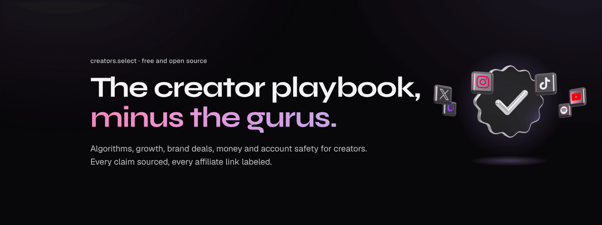
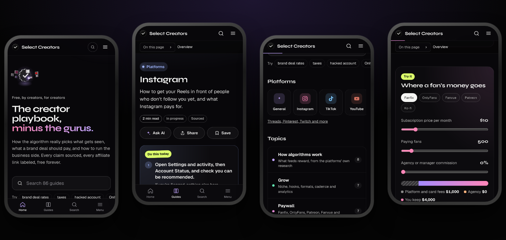
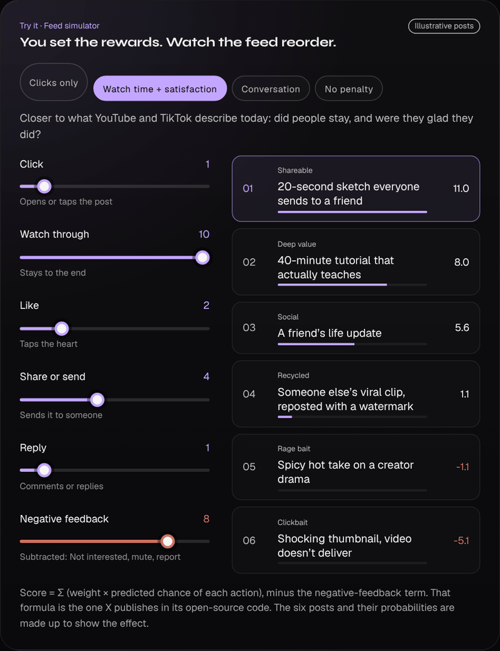
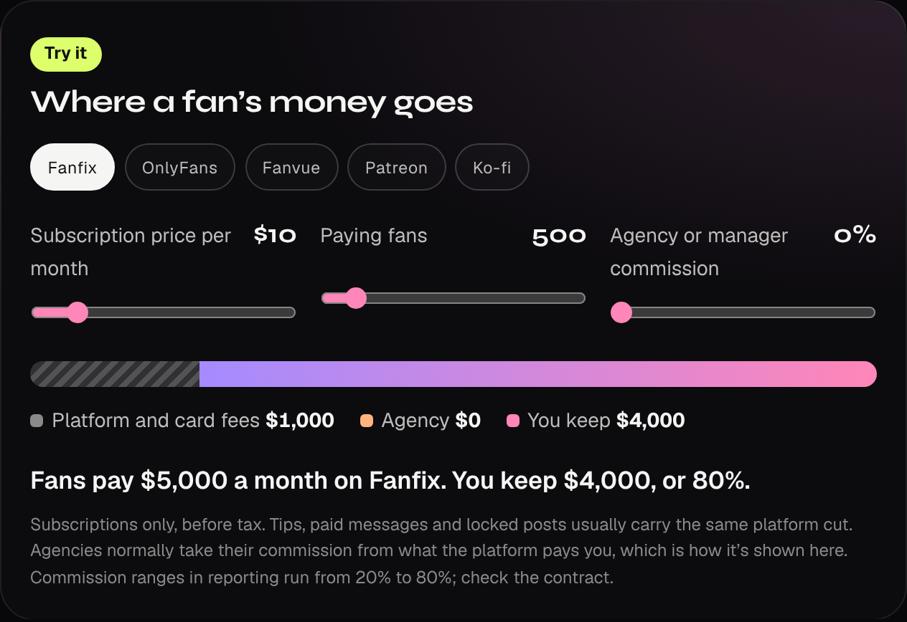
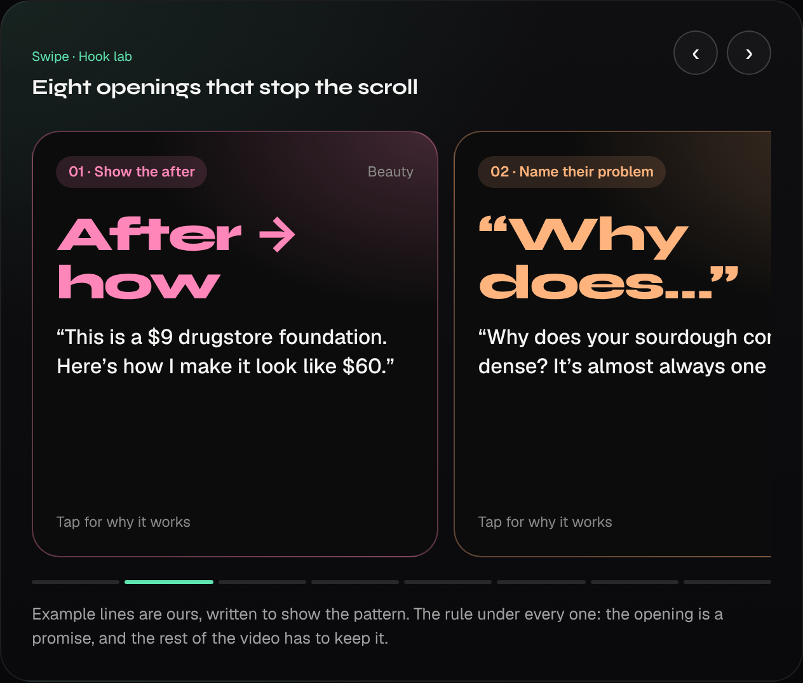
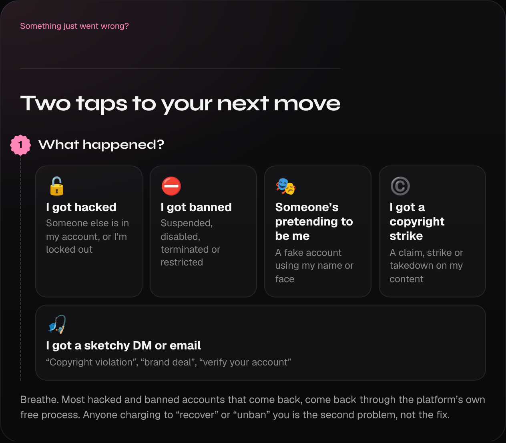

<div align="center">

<a href="https://creators.select">
  
</a>

<h3>The free, open-source handbook for the creator economy.</h3>

<p>Algorithms, growth, brand deals, money and account safety, written by people who do the work.<br>Every claim sourced. Every affiliate link labeled. Free forever.</p>

<p>
  <a href="https://creators.select"><b>Read it at creators.select</b></a>
  &nbsp;·&nbsp;
  <a href="https://creators.select/guides/">Browse all guides</a>
  &nbsp;·&nbsp;
  <a href="CONTRIBUTING.md">Contribute</a>
  &nbsp;·&nbsp;
  <a href="https://www.instagram.com/selectcreators/">Instagram</a>
</p>

<p>
  <a href="https://creators.select"></a>
  <a href="https://github.com/shifulaboratories/creators/actions/workflows/ci.yml"></a>
  <a href="LICENSE"></a>
  <a href="CONTRIBUTING.md"></a>
  
</p>

</div>

---

## Why this exists

Most creator advice online is a guess dressed up as a fact, sold by someone with a course to push. Select Creators is the opposite: a free handbook where every claim points to its source, from the platforms' own research papers and help pages to court records and published reporting. Practitioner opinion is allowed, but it is labeled as opinion.

It's built for working creators and the people around them: managers, agents, editors and brand partners.

<div align="center">
  
  <sub>Made for phones first: swipe between guides, save them for later, and share any stat straight to your Story.</sub>
</div>

## What's inside

**86 guides across 14 sections.** Each opens with the short version, most have a "do this today" checklist, and every one lists its sources.

| Section | What you'll learn |
| --- | --- |
| [**The algorithm**](https://creators.select/algorithms/) | How feeds decide what to show, what each platform optimizes for, and how to tell evidence from guru talk. |
| [**Platforms**](https://creators.select/platforms/) | Instagram, TikTok, YouTube, Facebook, LinkedIn and X side by side, plus five more. |
| [**Grow**](https://creators.select/grow/) | Niche, hooks, formats, posting cadence, the numbers worth reading, and how to run real experiments. |
| [**Brand deals**](https://creators.select/deals/) | Pitching, pricing, agencies and commissions, contracts and redlines, disclosure, getting paid. |
| [**Earn**](https://creators.select/earn/) | Every way creators get paid and what each one really pays. |
| [**Paywall platforms**](https://creators.select/paywall/) | Fanfix, OnlyFans, Patreon, Fanvue and Ko-fi compared, and what chatting agencies really do. |
| [**Money basics**](https://creators.select/money/) | Taxes, quarterly set-asides, LLC vs S corp, banking and getting paid across borders. |
| [**Team**](https://creators.select/team/) | Managers, agents, lawyers and agencies: who does what, what they cost, how to pick well. |
| [**Protect**](https://creators.select/protect/) | Hacked, banned, impersonated or hit with a strike? The official route back, in two taps. |
| [**Case studies**](https://creators.select/case-studies/) | How real creators think about growth, built only from their own words on the record. |
| [**Platform news**](https://creators.select/news/) | Dated, sourced algorithm, payout and rule changes, with what each one means for you. |
| [**Stack**](https://creators.select/stack/) | Tool picks for every budget, each with a free alternative. |
| [**The Shortlist**](https://creators.select/shortlist/) | The resources we'd send a friend: official explainers, top playbooks, open-source code. |
| [**Underground**](https://creators.select/underground/) | How the gray market (fake verification, ban services, account trading) works, so you can avoid it. Journalism only. |

## Learn by playing with it

Guides teach with interactive tools instead of walls of text. A few of them:

<table>
  <tr>
    <td width="50%" valign="top">
      <a href="https://creators.select/algorithms/how-recommenders-work/"></a>
      <p><b>Feed simulator.</b> Set what the feed rewards and watch six posts reorder, using the scoring formula X publishes in its open-source code.</p>
    </td>
    <td width="50%" valign="top">
      <a href="https://creators.select/paywall/compare/"></a>
      <p><b>Where a fan's money goes.</b> Pick a paywall platform, set a price, fans and agency cut, and see what you actually keep.</p>
    </td>
  </tr>
  <tr>
    <td width="50%" valign="top">
      <a href="https://creators.select/grow/hooks/"></a>
      <p><b>Hook lab.</b> Eight openings that stop the scroll, with why each one works.</p>
    </td>
    <td width="50%" valign="top">
      <a href="https://creators.select/protect/"></a>
      <p><b>Two taps to your next move.</b> Hacked, banned or impersonated? Get the official recovery route for your platform.</p>
    </td>
  </tr>
</table>

Also on the site: a brand deal rate calculator, a tax set-aside calculator, an S corp check, a platform-vs-platform comparer and more.

## The rules we hold ourselves to

- **Sources first.** The evidence ladder runs: published code, then the platform's own explainers, then platform staff on the record, then named practitioners. Anonymous guru claims are never cited.
- **Every page shows its confidence**: `verified`, `practitioner-view` or `speculative`.
- **Affiliate links are labeled where they appear**, and every tool pick names a free or non-affiliate alternative.
- **Conflicts are declared.** The team behind the site is building a talent agency, and we say so on [How we make money](https://creators.select/about/how-we-make-money/).
- **Ask AI on every page.** Hand any guide to ChatGPT or Claude in one tap. The whole site is also published as plain text at [`/llms.txt`](https://creators.select/llms.txt) and [`/llms-full.txt`](https://creators.select/llms-full.txt).

Full details: [Editorial standards](https://creators.select/about/editorial-standards/).

## Contributing

See what's being built on the [roadmap](https://creators.select/roadmap/) (from [Issues](https://github.com/shifulaboratories/creators/issues), rules in [docs/board.md](docs/board.md)) and what shipped in the [changelog](https://creators.select/changelog/) ([CHANGELOG.md](CHANGELOG.md), [how to release](docs/releasing.md)).

Spotted something wrong or out of date? That's the most useful thing you can tell us.

- **Quick fix:** every page has an "Edit page" link that opens the file here on GitHub.
- **Report or suggest:** [open an issue](https://github.com/shifulaboratories/creators/issues/new/choose) and pick a template (correction, guide idea, tool, or site bug).
- **Write a guide:** read [CONTRIBUTING.md](CONTRIBUTING.md) first, then open a guide proposal so a section editor can help shape it.

No coding needed for most changes. Guides are plain Markdown files.

## Run it locally

Requires Node 22.23 or newer.

```sh
git clone https://github.com/shifulaboratories/creators.git
cd creators
npm install
npm run dev      # http://localhost:4321
npm run build    # production build into dist/ (also checks every guide's frontmatter)
```

## How the repo is laid out

```text
src/
├── content/docs/     The guides: one Markdown or MDX file per page, a folder per section
├── data/             Tools, resources, videos, news and short versions as YAML and TypeScript
├── components/       Interactive widgets (calculators, simulators, swipe decks)
├── pages/            Home page, link-preview images and other custom routes
├── content.config.ts The rules every guide and tool must follow (the build fails if they don't)
└── site.mjs          Site name, description and repo link in one place
brand/                Logo, wordmark, colors and social images (see brand/README.md)
docs/                 How we publish: guide format, review queue, news, backlog
legal/                Lawyer review checklist for the Underground section
```

The site is static [Astro](https://astro.build) + [Starlight](https://starlight.astro.build), with search by [Pagefind](https://pagefind.app), deployed on Cloudflare Workers. No database, no tracking cookies, and nothing to run on a server.

## How the site makes money

Labeled affiliate links, clearly marked sponsorships, and the talent agency the team behind it is building. Details: [How we make money](https://creators.select/about/how-we-make-money/).

## License

- **Code:** [MIT](LICENSE).
- **Written content:** license to be decided (CC BY 4.0 or CC BY-NC-SA 4.0). Until then, all rights are reserved for the content in `src/content/`.

<div align="center">
  <br>
  <a href="https://creators.select">
    <picture>
      <source media="(prefers-color-scheme: dark)" srcset="brand/logo/lockup-horizontal-on-dark.svg">
      
    </picture>
  </a>
  <br>
  <sub>Made by <a href="https://bywilliaml.com">William Lee</a> and contributors.</sub>
</div>
